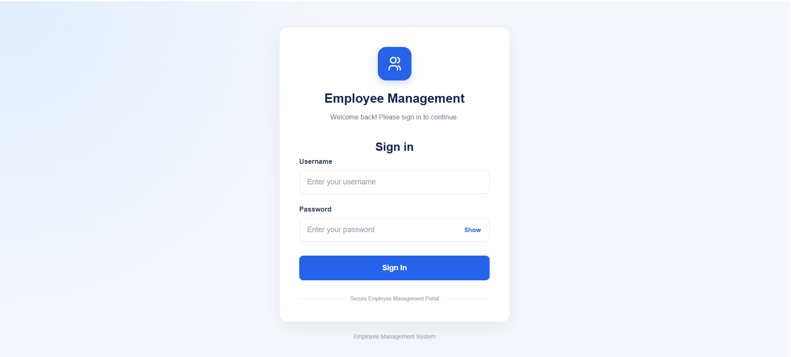
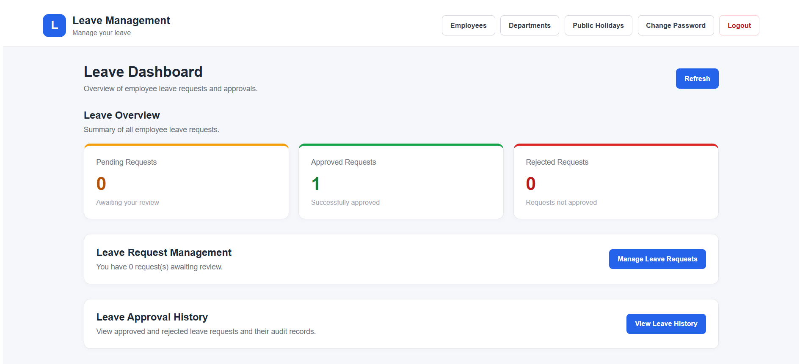
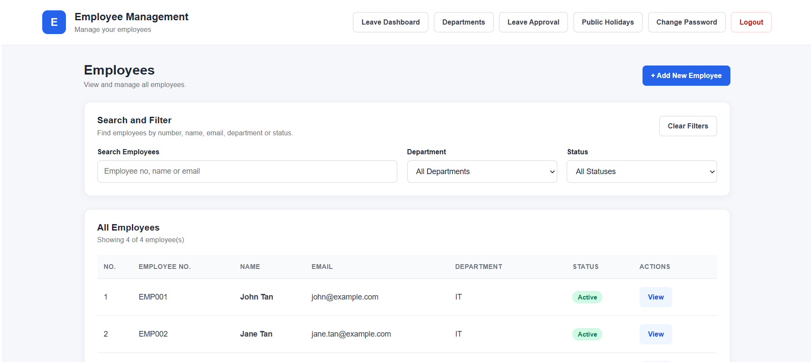
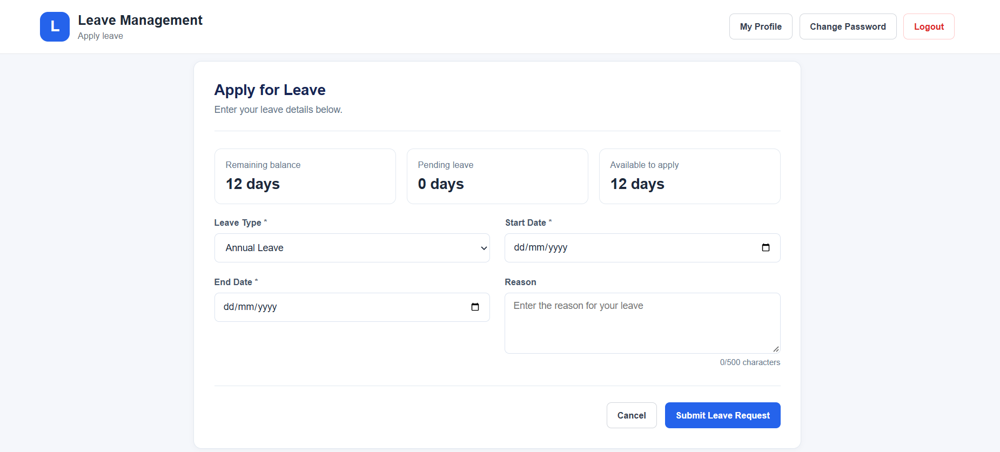
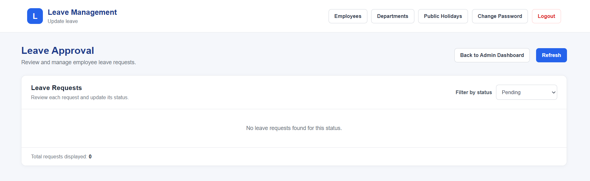

# Employee Management System

A full-stack Employee Management System built with **ASP.NET Core Web API, Angular, and SQL Server**. The application provides role-based access for administrators and employees, with employee record management and leave management features.

## Features

### Administrator
- Secure login and role-based access control
- Employee management (Create, Read, Update, Delete)
- Department management
- Review and approve or reject employee leave requests
- View leave request records and history
- Manage and update employee leave entitlements and balances
- Manage public holidays

### Employee
- Secure login
- View employee information
- Submit leave applications
- Cancel pending leave requests
- View leave application status and history
- Check leave entitlement and available balance
- Change password

## Leave Management
- Submit and validate leave applications
- Prevent overlapping leave requests
- Calculate working days while excluding weekends and configured public holidays
- Track leave entitlements, used days, and remaining balances
- Approve or reject pending leave applications
- Allow employees to cancel pending leave requests
- Maintain leave request status history and audit logs

## Technology Stack

| Layer | Technology |
|---|---|
| Backend | ASP.NET Core Web API (.NET 8) |
| Frontend | Angular |
| Database | Microsoft SQL Server |
| Authentication | JWT (JSON Web Tokens) |
| API Documentation | Swagger / OpenAPI |
| Testing | .NET automated tests |
| Version Control | Git and GitHub |

## Project Structure

EmployeeManagementSystem/
├── EmployeeManagement.Api/       # Backend API
├── EmployeeManagement.Client/    # Angular frontend
├── EmployeeManagement.Tests/     # Automated tests
├── EmployeeManagement.Api.sln
└── .gitignore

## Architecture

The application uses a client-server architecture:

1. The Angular frontend provides the user interface.
2. The frontend communicates with the ASP.NET Core Web API through HTTP requests.
3. The API handles business logic, validation, authentication, and authorization.
4. SQL Server stores application data.
5. JWT authentication and role-based authorization protect restricted functionality.

## Getting Started

### Prerequisites

Install the following development tools:

- .NET 8 SDK
- Node.js and npm compatible with the Angular project
- Angular CLI compatible with the project
- Microsoft SQL Server
- Visual Studio or another suitable code editor

### 1. Clone the repository

git clone https://github.com/Chai888/EmployeeManagementSystem.git
cd EmployeeManagementSystem

### 2. Configure the database

Configure the SQL Server connection string using your local development settings.

Before running the application:

- Create or restore the required database.
- Apply the database schema or migrations used by the project.
- Configure authentication secrets through local development settings or environment variables.
- Never commit real passwords, connection-string credentials, or JWT secrets.

### 3. Run the backend

Open `EmployeeManagement.Api.sln` in Visual Studio, configure the API's local settings, and run the `EmployeeManagement.Api` project.

Open Swagger to explore and test the available API endpoints.

### 4. Run the frontend

Open a terminal in the Angular project directory:

cd EmployeeManagement.Client
npm install
ng serve

Open the local URL displayed by Angular in your browser.

> Note: The database configuration, API URL, and local HTTPS settings must match your environment.

## Testing

The backend automated test suite has been executed successfully.

**Latest recorded result:** 64 passed, 0 failed, 0 skipped.

To run the tests:

dotnet test EmployeeManagement.Tests/EmployeeManagement.Tests.csproj

## Screenshots

Screenshots of the login page, administrator dashboard, employee management, and leave management pages will be added here.

## Deployment

- Frontend: Azure Static Web Apps
- Backend: Azure App Service
- Database: Microsoft SQL Server / Azure SQL Database

## Future Improvements

- Configure CI to run automated tests on every push
- Expand SQL Server concurrency test coverage
- Improve application monitoring and error logging
- Enhance API and deployment documentation

## Screenshots

### Login Page

### Admin Dashboard

### Employee Management

### Leave Application

### Leave Approval

## Author

**Chai888**

GitHub: https://github.com/Chai888
